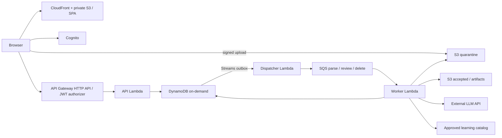

# GG Poker MTTレビューアプリケーション設計書

更新日: 2026-09-26 / 状態: 設計レビュー指摘反映済み・実装前

## 1. 目的・境界

確定要件は `../REQUIREMENTS.md` を正とする。GG Poker MTT履歴をアップロードし、自分のハンドを選択して日本語レビューを得るAWSサーバーレスWebアプリを作る。ユーザー間で元ファイル、ハンド、ジョブ、レビューを分離する。既存Notion理論資料の完成は別成果物だが、承認された資料をレビューから参照する。

初期版の設計提案は通常のNo-Limit Hold'em MTT、UTF-8（BOM可）の単一TXT。キャッシュ、ZIP、画像/OCR、ライブ対局支援、PKOの賞金EV、ソルバー実行、全履歴一括AIレビュー、ユーザー間共有は対象外。対応するGG Pokerの言語・実際のヘッダー・形式は匿名化した実データで確定する。未知形式を成功扱いしない。

既存 `../../legacy/python/src/gg_history_parser.py` はドル表記のブラインド・アクションを中心とする試作で、座席、スタック、アンティ、サイドポットの再現を提供していない。`../../legacy/python/src/review_app.py` は全ハンドを一度に送信し、LLMを「GTOソルバー」と呼び頻度・採点を要求する。これらを本番仕様として継承しない。実装変更は本設計作業の対象外。

## 2. 利用フロー・画面

1. Cognitoで登録・ログインする。
2. 履歴一覧からTXTを選択する。送信前にサイズ・形式・外部AIへの匿名化データ送信について表示する。
3. アップロード後、解析待ち・解析中・完了・一部失敗・失敗を表示する。
4. ハンド一覧から選択し、座席、Hero、各時点のボード、チップ/BB、ポット、アクションを確認する。
5. 任意の大会情報を追加入力し、ハンド単位でレビューを要求する。
6. ジョブをポーリングし、結果・不足情報・改善点・資料リンクを表示する。再読み込み後も結果が残る。
7. ファイル単位で関連ハンド・レビューをまとめて削除できる。削除受付後は即座に非表示・アクセス拒否とし、物理削除の完了を表示する。

画面はログイン、履歴一覧/アップロード、ハンド詳細/レビュー、アカウント設定の4領域。初期版はユーザーがモデル名を入力するUIを設けない。エラーは修正方法と問い合わせ用requestIdを表示し、内部例外や他ユーザーの存在を返さない。

## 3. 構成

[draw.io形式のアーキテクチャ図](diagrams/gto-analyzer.drawio)の「MTT全体構成」ページで構成を編集できます。

- 静的配信用S3と機密データ用S3を分離。両方Block Public Access有効、静的配信はCloudFront OACのみ。履歴バケットをCloudFrontへ接続しない。
- API Gateway HTTP API + Cognito JWT authorizer。API Lambda、parse/review/delete worker、outbox dispatcherを職責別に分ける。
- DynamoDBオンデマンド、暗号化、PITR。履歴S3も暗号化・TLS必須。APIキーはSecrets Managerでreview workerのみ読み取り可能。
- Lambdaは初期版VPC外で実行し、NAT Gateway常時費用を避ける。外部LLMへの送信は匿名化した正規化ハンドに限定する。
- 新規実装はTypeScriptに統一する（[ADR-0001](decisions/0001-typescript.md)）。CDKで環境構築、SPAはReact案、API・parser・workerもTypeScript。AWSリージョンは東京案、dev/prodを分離する。

## 4. 認証・認可

Cognito Hosted UIのAuthorization Code + PKCEを使う案とする。JWT authorizerでissuer、audience、期限と必要scopeを検証し、全保護routeに専用API scopeを要求し、APIでも`token_use=access`と`sub`を確認する。トークンはブラウザメモリ中心とし、永続localStorageへの保存を避ける。CORSは本番SPAのoriginのみ。CSPと出力サニタイズを適用する。

所有者は検証済みJWTの`sub`のみから取得する。HTTP body/query/pathにownerIdを受け付けない。すべてのDBアクセスはこのownerIdからキーを構成し、取得後も対象のownerId・親uploadId・削除状態を確認する。Account/Uploadの認可確認にはConsistentRead=trueを使い、一覧もベーステーブルの強整合Query後に親状態を照合する。削除トランザクション確定後に始まる認可は必ず拒否する。既に認可済みの進行中応答やユーザーが保存済みのコピーは回収できない。他人のIDと存在しないIDはともに404を返す。推測困難なIDは認可の代替ではない。

SQSメッセージのownerIdはサーバー内部情報として扱うが、それだけでは信用せず、ジョブ、親upload、対象ハンドの整合性をDBで再確認する。workerは本文から任意S3キーを読み込まず、DBの確定済み参照を使用する。共有実行ロールでのアプリ認可が主要境界であり、DynamoDBキーだけでAWS IAMによるテナント隔離が成立するわけではない。最小権限ロール、コード共通のowner-scoped repository、交差アカウント試験を必須にする。

## 5. アップロードと改ざん・上書き対策

1. `POST /uploads`でファイル名（表示専用）、サイズ、SHA-256を受け、アカウント容量を予約する。サーバーがuploadIdと一意のquarantineキーを生成する。
2. 5分有効の署名付きPOSTを返す。policyは固定key、content-length-range、content-type、チェックサムを拘束する。ブラウザの事前検証だけには依存しない。
3. クライアントがS3へ直接送信し、`POST /uploads/{id}/complete`を呼ぶ。APIは所有者、状態、S3のサイズ・チェックサムを検証し、その時点のVersionIdを記録する。quarantineバケットはバージョニング有効。完了確定は条件付き更新で1度だけ行う。
4. workerは記録したVersionIdのオブジェクトを読み、ハッシュ・実サイズ・文字コード・構文を再検証する。accepted領域へサーバー専用キーで固定コピーし、その固定キー・VersionId・checksumをUploadへ条件付き保存する。原本ダウンロードはこのaccepted参照だけを使い、quarantine掃除後も取得できるようにする。accepted確定前は原本ダウンロードを409で拒否する。署名URL再利用でquarantineへ後から別バージョンが書かれても解析対象が変わらない。
5. テキストのみ、10 MiB以下、1,000ハンド以下を初期値案とする。NULLバイト、不正UTF-8、圧縮内容、過大な1ハンド、未知ゲーム形式を拒否する。MIMEと拡張子だけでは判定しない。ハンド上限超過はファイル全体を拒否する。
6. 正常なハンドと不正ハンドが混在した場合はハンド単位の検証結果と件数を保存し、`PARTIAL`を返す。不正ハンドはレビュー不可。

署名付きURLは有効期限内に再使用できるため、単回利用を前提にしない。[AWS S3署名URL仕様](https://docs.aws.amazon.com/AmazonS3/latest/userguide/using-presigned-url.html)

元ファイルのダウンロードはAPI Lambda経由の所有者検証付き分割取得とする。SPAが単一Rangeで最大1 MiBずつ要求し、Lambdaは固定VersionIdのS3 Range GETを206で返す。Rangeなし・複数Range・上限超過は拒否し、範囲外は416。各分割要求でAccount/Uploadを再認可し、ブラウザで結合してSHA-256を検証する。これにより10 MiBのアップロードと、Lambda同期応答の6 MB上限（Base64増分も含む）を両立させる。取得済みデータの回収や削除前に認可済みの進行中応答の取消は保証しない。[Lambda応答制限](https://docs.aws.amazon.com/lambda/latest/api/API_Invoke.html)、[S3 Range GET](https://docs.aws.amazon.com/AmazonS3/latest/API/API_GetObject.html)。機密データへの長寿命GET署名URLは採用しない。未完了アップロードは24時間後に予約解除、quarantineの全バージョンはLifecycleと掃除処理で削除する。

## 6. 正規化ハンド・MTT評価

`NormalizedHand`にはschemaVersion、parserVersion、sourceHandId、sourceSpan、tournamentId、日時（原表記/timezone不明フラグ）、gameType、blindLevel、sb/bb、ante形式、buttonSeat、heroSeat、players、actions、streetBoards、pots、validationを持つ。欠損はnullと理由を持ち、0に置換しない。数値はチップ最小単位の整数を原則とし、小数表記を許容する形式では十進文字列から最小単位整数へ変換する。TypeScriptのnumberは安全整数の範囲を検証し、範囲外は拒否する。必要に応じてbigintまたは十進演算ライブラリを採用し、JSON境界は十進文字列として契約を定義する。浮動小数点でポットを計算しない。

playerはseat、匿名ID、開始スタック、既知カードを持つ。アクションは順序、street、actor、種類、投入増分、street累積投入、残りスタック、potBefore/potAfter、allIn、sourceSpanを保持する。raise-toと投入増分を分離し、ブラインド/アンティ、uncalled bet返却、all-in、サイドポット、賞金/獲得ポットを区別する。Heads-upのBTN/SBを含め座席からポジションを決める。実効スタックは対戦相手・意思決定時点を明示し、multiwayで単一の値へ潰さない。

各streetのカードとアクション時点の情報だけを意思決定評価へ渡す。後で公開された相手カードや結果による後知恵評価を防ぐ。カード重複、負スタック、投入/返却/ポット不整合、アクション順不明、欠落行を検出する。再現不能なハンドをLLMで補修しない。

追加入力は大会種別、残り人数、総参加人数、賞金表、各残存者スタックの可用性、バウンティ情報、Hero戦略メモ。入力元（履歴/ユーザー）とrevisionを保存する。初期版はチップEV観点の定性的レビューを基本とし、バブル等は定性的なICM注意点のみ。賞金表や全残存スタックがなければ数値ICMを算出しない。十分な入力があってもICM計算エンジンを実装していない初期版は「ICM未計算」と表示する。

## 7. DynamoDBデータ設計

単一テーブル `PokerReview`、PK/SK文字列。ユーザー別パーティションに一覧用の軽量レコードを置き、大きいJSONはS3へ保存する。全JSON/レビュー本文は256 KiB上限案、超過はS3へ分離し、DynamoDB itemは350 KiB未満のアプリ上限を設ける。S3 artifactはuploadId/jobId/fence/artifactIdを含む試行別キーへ条件付き新規作成し、上書きしない。キー、VersionId、checksumをDBに記録し、fence検証に成功した参照だけを公開する。古いworkerのartifactは孤立物として掃除し、確定済み参照の実体を変更できないようにする。

| レコード | PK | SK | 用途 |
| --- | --- | --- | --- |
| Account | `U#{sub}` | `ACCOUNT` | 状態・利用上限・予約容量 |
| Upload | `U#{sub}` | `UPLOAD#{id}` | 所有者・状態・generation・固定S3 version |
| Upload一覧 | `U#{sub}` | `UL#{createdAt}#{id}` | 新しい順の一覧、状態の軽量投影 |
| Hand | `U#{sub}#UP#{uploadId}` | `HAND#{id}` | 正規化参照・表示要約 |
| Review | `U#{sub}#UP#{uploadId}` | `REVIEW#{handId}#{id}` | revision、結果、根拠 |
| Hand一覧 | `U#{sub}#UP#{uploadId}` | `HL#{ordinal}#{id}` | 順序付き軽量投影 |
| Review一覧 | `U#{sub}#UP#{uploadId}` | `RL#{handId}#{createdAt}#{id}` | 日時順軽量投影 |
| ReviewGuard | `U#{sub}#UP#{uploadId}` | `RG#{handId}#{requestHash}` | 現在job・attempt世代、重複抑止 |
| Deletion | `U#{sub}` | `DELETE#{deletionId}` | 削除job状態・lease・進捗・監査台帳 |
| DeleteOutbox | `U#{sub}` | `DELETEOUTBOX#{deletionId}` | 削除キュー配信、対象upload参照 |
| Job | `U#{sub}#UP#{uploadId}` | `JOB#{id}` | 状態・lease・試行・fence |
| Idempotency | `U#{sub}` | `IDEM#{operation}#{keyHash}` | requestHash・既存応答・期限 |
| Outbox | `U#{sub}#UP#{uploadId}` | `OUTBOX#{jobId}` | 配信状態・nextAttempt |

ハンドID単独での検索を初期APIに設けず、uploadIdとともに指定する。upload一覧はベーステーブルのUL prefix Query、ハンド一覧はupload partitionのHL prefix Query、レビュー履歴はRL+handId prefix Query。必要な詳細は完全キーGetItemを使用する。ScanをユーザーAPIに使わない。ページングはLastEvaluatedKeyを改ざん検知付き不透明cursorにし、ownerと検索条件を拘束する。50件/ページ案。

運用専用GSI `PendingWork` は未配信outbox/処理期限超過jobのみ投影し、PK=`WORK#{kind}#{shard}`、SK=`{nextAttempt}#{ownerId}#{uploadId}#{jobId}`。shardは固定16案。利用者からこの索引へ直接アクセスさせない。GSIの結果は候補に過ぎず、ベーステーブルの条件付き更新で状態を確定する。

Account状態、Upload状態/generation、Job状態/fence、結果更新をTransactWriteItemsでまとめ、削除との競合に勝てない古いworkerは結果を公開できなくする。一括1,000ハンドの原子書き込みは行わない。少数件ごとに親状態のConditionCheckと条件付きPutを行い、全件成功後のみuploadをREADY/PARTIALへ遷移する。解析中の一覧は公開しない。DynamoDBのtransactionは最大100 distinct itemで、同一itemへのConditionCheckとUpdate併用はできないため、更新対象自身にはUpdate条件を書く。[AWS transaction仕様](https://docs.aws.amazon.com/amazondynamodb/latest/developerguide/transaction-apis.html)

## 8. 非同期処理・冪等性

Upload: `PENDING_UPLOAD → QUEUED → PARSING → READY | PARTIAL | FAILED`。どの状態からも`DELETING → DELETED`へ遷移可。Job: `QUEUED → RUNNING → SUCCEEDED | FAILED | CANCELLED`。一時障害はRUNNINGのlease失効後に再取得し、試行上限到達でFAILED。永久障害は直ちにFAILED。

レビュー要求にはIdempotency-Keyを必須とし、owner、hand内容hash、contextRevision、promptVersion、model設定、catalogVersionからrequestHashを作る。同じキー/同じ内容は既存jobを返し、同じキー/異なる内容は409。ReviewGuardを条件付きで取得し、同一requestHashでQUEUED/RUNNING/SUCCEEDEDなら既存jobを返す。FAILEDの場合だけ新しいIdempotency-Keyでの再要求により、旧jobのFAILED状態とGuard世代を条件に新jobを作り、Guardのattempt世代を増やす。同じIdempotency-Keyの再送は失敗を含む元の応答を返し、新実行にしない。新revisionは別requestHashとなる。contextは変更不能のrevisionスナップショットとしてjobに固定し、後から更新された値をworkerが参照しない。

APIはJob、Outbox、冪等性レコード、使用量予約を同一transactionで保存し202を返す。DB保存とSQS送信の間で停止しても仕事を失わないよう、DynamoDB Streams dispatcherが未配信outboxをSQSへ送信してから配信済みにする。送信後DB更新前の停止による重複はworkerで吸収。EventBridge定期LambdaがPendingWorkを照会して未配信/lease失効を再投入する。Streams障害や保持期間超過でもDB outboxを回復源とする。

workerは条件付き更新でleaseと単調増加fenceを取得し、期限前のheartbeatで更新する。最終保存は親generationと自分のfence一致が条件。SUCCEEDED/CANCELLED/DELETEDのメッセージは処理せずACKする。lease競合は成功扱いで捨てず、遅延再試行する。SQS Standardはat-least-onceなので、exactly-onceを主張しない。[AWS SQS/Lambdaの配信仕様](https://docs.aws.amazon.com/lambda/latest/dg/with-sqs.html)

parse/review/deleteのキューとDLQを分離。review workerは1メッセージ/呼び出し、timeout 120秒、visibility 720秒、maxReceiveCount 5を初期値案にする。外部LLM timeoutは90秒以下とし、書き込みの余裕を残す。複数件batchを使う処理では部分失敗応答を有効にする。visibilityは関数timeoutの6倍＋batch window以上とする。[AWS設定指針](https://docs.aws.amazon.com/lambda/latest/dg/services-sqs-configure.html)

LLM呼び出し成功直後にworkerが停止した場合、外部APIの課金を含む完全な重複排除は保証できない。再試行回数と支出上限を制限し、attempt ID・token数・プロバイダrequest IDを記録する。ユーザーには単一の確定結果だけを公開する。

## 9. API契約

共通: `/v1`、JWT必須、JSON、requestId、UTC ISO8601、上限付きpage/cursor。GETは所有者・親状態を毎回確認。202はjobId/statusUrl、エラーは`code/message/requestId/retryable`を返す。400入力、401未認証、404不存在/他人/削除済み、409競合、413上限、422非対応形式、429利用上限、503一時障害。

| Method / path | 入出力・動作 |
| --- | --- |
| POST `/uploads` | filename/size/sha256 → uploadId、署名POST条件、有効期限 |
| POST `/uploads/{id}/complete` | S3検証・版固定 → parse job（冪等） |
| GET `/uploads` | 所有履歴の一覧 |
| GET `/uploads/{id}` | 状態、件数、エラー要約 |
| GET `/uploads/{id}/source` | 元ファイルの認可付き取得 |
| GET `/uploads/{id}/hands` | 正常/不正ハンドの一覧と検証結果 |
| GET `/uploads/{id}/hands/{handId}` | 正規化局面 |
| PUT `/uploads/{id}/hands/{handId}/context` | expectedRevision付き追加入力更新 |
| POST `/uploads/{id}/hands/{handId}/reviews` | Idempotency-Key、contextRevision → jobId |
| GET `/uploads/{id}/hands/{handId}/reviews` | レビュー履歴 |
| GET `/uploads/{id}/hands/{handId}/reviews/{reviewId}` | 結果・根拠・不足情報 |
| GET `/uploads/{id}/jobs/{jobId}` | 状態、再試行可否、エラー |
| DELETE `/uploads/{id}` | 削除受付202、再送は同じ削除状態 |
| GET `/me/deletions/{deletionId}` | Account側DELETEレコードを所有者キーで取得し、削除状態のみ返す（元データなし） |

画面は2秒開始、最大15秒のバックオフでjobをポーリングし、非表示タブでは停止する。再試行は新規レビュー要求で既存失敗jobを履歴に残す。ダウンロード応答はattachment、nosniff、Cache-Control: no-store。

## 10. レビュー品質・Notion資料

出力JSON schemaはsummary、decisionReviews、missingInformation、assumptions、learningReferences、provenanceを持つ。observed事実とcalculated数値はサーバー側で構築し、LLMによる編集・自己申告で確定させない。LLMはactionId/metricIdを参照して説明を生成し、表示数値は検証済み値から解決する。参照先、局面時点、単位を検証し、自由文の根拠のない数値は拒否する。各主張に`observed`（履歴）、`calculated`（決定的計算）、`inferred`（LLM推論）、`solver_verified`（将来の計算結果）の種別を持たせる。初期版ではsolver_verifiedを許容しない。

計算できるポット、SPR、コールに必要なポットオッズはコードで算出し、条件（side pot、rake等）も保存する。期待値・混合頻度・最適レンジはソルバー未接続なら確定値を出さない。LLMによる推奨は定性的助言であり「GTO正解」「正確なEV loss」と表示しない。単一ハンドからプレイヤータイプや100点採点を断定しない。未知カードを既知として扱わない。

プロンプトへ送るのはHero/P1/P2等へ置換した正規化データと必要な局面情報のみ。元プレイヤー名、メール、Cognito sub、S3パス、原文全体を送らない。履歴文字列は命令ではなくデータとして扱い、LLMにツール実行権限を与えない。出力schemaと許可された資料IDを検証し、違反結果は修復回数を制限して失敗扱いにする。HTMLは表示せずMarkdownのリンクschemeを制限する。

Notion資料は公開/アプリ全ユーザー共有の承認を得た理論ページだけをバージョン付きカタログへ取り込む。既存Notion内の個人ハンド、実名、非公開メモを混ぜない。カタログにはstableId、title、topic、version、sourceUrl、共有可否、検証日を保存する。各資料の読者権限が整うまでリンクを表示しない。アプリが既存Notion全体を自動共有したり、ユーザーの履歴をNotionへ書き戻すことはしない。レビューにはcatalogVersionと参照IDを保存し、後から再現できるようにする。

## 11. 削除・保持

削除APIはUploadをDELETINGにしてgenerationを増加させ、UL一覧投影も更新し、Account側partitionのDeletion/DeleteOutboxを同じtransactionで登録する。削除ジョブは通常ジョブとは異なる保存先だが同じlease/fencing規約を用い、PendingWorkにも削除タスクのキー種別を明示して投影する。以後、新規レビュー・ダウンロード・worker確定書き込みを拒否する。進行中LLM呼び出しを確実に停止できるとは限らないが、結果は公開・保存しない。

delete workerはupload partitionをページングしHAND/HL/REVIEW/RL/RG/JOB/OUTBOXの各prefixを削除（削除制御レコードはこのpartitionに置かない）、S3の原本/派生物/quarantineの全バージョンを削除する。DB削除とS3削除は原子的でないため、カーソルと失敗対象を保存して再実行する。古いworkerがS3へ書き込んだ後DB保存に失敗する場合に備え、成果物キーはupload配下固定、最終掃除を最大worker実行時間と署名URL期限の後に再実施する。親tombstoneは保持し、孤立オブジェクト定期掃除も行う。削除済み親は後続イベントで再生成しない。

通常データはユーザー削除まで保持、未完了uploadは24時間、tombstoneおよびAccount側の削除台帳は90日、ログは30日、PITR復旧可能期間は35日を初期値案とする。DLQ/SQSの保持上限より長くtombstoneを保持する。期限切れメッセージは親なしならACKして再生成しない。TTLは非同期掃除にのみ利用し、即時の認可や削除完了判定に使わない。[AWS TTL仕様](https://docs.aws.amazon.com/amazondynamodb/latest/developerguide/TTL.html)

バックアップ上の消去は保持期間満了まで遅れることを設定画面に明示する。復元は別環境へ行い、復元時点までの最新の削除台帳を再適用してから公開する。削除台帳は独立した非公開S3バケットにも保存する。削除workerは台帳の複製確認を物理削除の前提条件とし、未複製は再試行・監視対象とする。このバケットはupload配下の削除やDB復元の対象に含めない。復旧担当は最新DBのDELETING/DELETED情報と複製台帳を照合し、最新削除情報を取得できない場合はサービスを公開しない。削除台帳は全バックアップの復元可能期間＋復旧作業の余裕を超えて保持する。初期版では35日を超える手動バックアップを作らず、保持を延長する場合は台帳期間も先に延長する。退会はAccountをDELETINGにし全uploadの削除を開始、利用停止とデータ掃除を先に行ってからCognitoユーザーを削除する。

## 12. 運用・利用上限

CloudWatchにはrequestId/jobId、処理時間、状態、エラーコード、token数だけを記録し、原文・カード・JWT・署名URL・AI本文は標準ログに出さない。認可失敗数、queue age、DLQ件数、outbox滞留、lease期限超過、LLM失敗/費用、DynamoDB throttlingを監視する。DLQは原因修正後、親状態とgenerationを照合して再投入する。AWS Budget通知と外部LLMの予算上限を別々に設定する。

初期上限案: ユーザーあたり保存100 MiB、1日20レビュー、同時レビュー2件、システムreview worker並列5、全体LLM日額上限。レビュー受付transactionで日次利用枠を予約し、成功/確定失敗時に精算する。外部呼び出しが発生した失敗は費用計上し、再試行で上限を迂回できないようにする。予算の具体額は運用開始前に確定する。

## 13. 検証と受入

| 領域 | 必須検証 |
| --- | --- |
| 実履歴 | 匿名化GG MTT実ファイルをfixture化。通常/ante/BB ante/HU/all-in/short call/side pot/split pot/返却/途中終了/未知形式の期待状態と照合 |
| 局面 | 金額保存則、カード整合性、raise-to、stack/position、street別board、未来情報が推奨に混入しないこと |
| 分離 | A/Bの実アカウントで全API、cursor、S3参照、job、download、context更新、削除を交差試験。404・副作用なし |
| アップロード | 上限、偽MIME、不正UTF-8、同名、再送、署名再利用、complete後上書きでも固定版解析 |
| 非同期 | 重複配信、DB確定後送信前停止、送信後状態更新前停止、lease失効、古いfence、部分失敗、DLQ復帰 |
| 削除 | PARSING/RUNNING中、署名発行後、S3書込直後、結果確定直前の削除で公開復活しない。全version掃除 |
| レビュー | schema、未計算EV断定拒否、ICM不足表示、匿名化、prompt injection、Notion参照の許可リスト |
| AWS統合 | stagingで登録→実TXT→一覧→レビュー→再ログイン→結果→削除まで通し、監視と利用上限も検証 |

UI性能案は一覧/詳細API p95 1秒以内（負荷・cold start別計測）、解析/レビューは非同期。レビュー時間の保証はモデル・実データ計測後に定める。本設計段階では実装テスト・AWSデプロイが済んだとは扱わない。

## 14. 実装順序・移行

1. 実MTT fixtureと形式対応表を確定し、parser v2と局面再構成を先行する。
2. IaC、認証、owner-scoped repository、非公開S3、署名upload/固定版解析、一覧・詳細を作る。
3. outbox/SQS/lease/削除競合を検証してからLLM adapterを接続する。
4. レビューschema、計算モジュール、承認済みNotionカタログ、UIを接続する。
5. 交差アカウント試験・障害注入・staging受入を完了して運用へ進む。

既存Streamlitは `legacy/python/` にローカル試作として残し、公開サービスへ直接転用しない。旧JSONにはownerがないため、自動でユーザーに割り当てない。移行が必要なら本人が元履歴を再アップロードする。schemaVersionを常に保存し、非互換変更は新parserで再解析したrevisionを作る。既存レビューは元parser/model/prompt/catalog versionに結び付けて保持する。

## 15. 確定待ち事項

以下は設計案でありユーザー合意済みの要件に昇格させない。実装に必要な合理的初期値は上記に示した。

- GG Poker実MTTサンプルと対応言語、通常MTT以外（PKO等）の扱い。
- 東京リージョン、ログイン方式、SPAフレームワーク。TypeScript統一とCDK方針はADR-0001を参照。
- ファイル/件数/利用上限、保存期間、退会・バックアップ消去方針。
- LLMプロバイダ/モデル、処理地域と外部送信条件、費用上限。
- Notion資料の対象ページ・完成基準・アプリ利用者への共有承認。
- 実装時に分割ダウンロード、認可、チェックサム検証をAWS統合試験で確認する。

## 16. 学習画面の先行移行（2026-10-03）

[Poker Spot Visualizerの移行設計](POKER_SPOT_AWS.md)に従い、既存Sitesの学習画面をGitへ取り込み、React/TypeScriptへ移植してS3 + CloudFrontのAWS devで検証する。この作業は§14のMTT実装と独立して先行できる。学習画面の配信成功を、履歴解析・認証・アカウント分離の完了とは扱わない。履歴・ユーザーデータを扱う際は本設計の認証、認可、API、永続化を適用する。

### 共通Web基盤の実装（2026-10-04）

学習画面とMTTレビュー画面は同じReact SPA／S3／CloudFrontへ統合する。学習画面を最初の機能として`apps/web/src/features/spot`へ実装し、JSON契約を`packages/contracts`、計算を`packages/domain`へ分離した。`infra`に共通Web dev配信のCDKを追加した。後続のCognito・API・DynamoDB・機密履歴用S3・workerは同じアプリの基盤へ追加する。レビュー機能およびAWSリソース作成は未実施。学習画面のIP許可はアカウント認証の代替にはしない。
