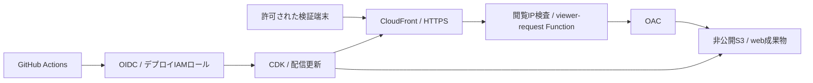

# Poker Spot Visualizer: Git統合・AWS移行設計

- 更新日: 2026-10-03
- 状態: Draft（ローカルリポジトリへの元ソース取込・検証は完了。AWS構築・デプロイは未実施）
- 関連: [全体設計](DESIGN.md)、[受入仕様](../specs/SPOT-001-visualizer.md)

## 目的と現在地

既存のPoker Spot Visualizerを `Heroyuki/gto-analyzer` で管理し、AWS上で操作確認できるようにする。まず独立した学習画面を移行し、その後にGG Poker MTT履歴のレビュー画面へ統合する。

現在のURL https://poker-spot-lab.heroyuki.chatgpt.site/ はOpenAI Sitesの配信先であり、AWS環境ではない。取得したSitesソースのコミットは `5b2f88971d0dd1537b7849ce79d53220e1e6d877`。GitHubリポジトリとは自動同期していない。現行Sitesの閲覧設定は所有者のみである。

現行実装は依存ライブラリなしのHTML/CSS/JavaScript。カード選択、SPR、コール必要勝率、169分類のレンジ、JSON入出力を備える。状態はブラウザーのメモリー内にあり、再読み込みで初期化される。バックエンド、DB、ログイン、GTO計算、MTTパーサーはない。説明用頻度とユーザー持込戦略を表示するアプリであり、ソルバーではない。

## 移行の方針

| 段階 | 成果物 | 完了の判断 |
| --- | --- | --- |
| 1. ソース取込 | 元ソース・テストを `legacy/poker-spot/` に保存。取得元・コミットを記録 | 元の6テストと構文検査が成功し、ローカルで画面を操作できる |
| 2. TypeScript化 | `apps/web` にReact + TypeScript + Viteの画面、`packages/domain` に純粋計算、`packages/contracts` に入出力型 | 元の機能と追加受入試験が成功。表示・計算の移植漏れなし |
| 3. AWS dev | CDKでS3、CloudFront、検証用閲覧制限、配信手順を作成 | AWSのHTTPS URLで受入操作、未許可アクセス拒否、旧版復旧を確認 |
| 4. 履歴アプリ統合 | 認証、API、DynamoDB、履歴パーサーから局面データを供給 | 全体設計の認可・MTT・ジョブ受入条件を別途満たす |

第1段階のJavaScriptは既存試作の保存であり、[ADR-0001](decisions/0001-typescript.md)の新規本番コードTypeScript方針は維持する。移植前から浮動小数点の計算を本番のチップ計算として流用しない。

## Gitとコードの境界

GitHubを以後の変更管理の正本とし、専用 `codex/` ブランチとPRで取り込む。既存の未送信コミットや作業内容は保持し、履歴を書き換えない。

Sitesのソースはファイルとして取り込み、内側の `.git` や一時認証情報を含めない。Sitesの `.openai/hosting.json` はAWS用設定として取り込まない。元の `dist/` は実際の手書きソースなので、保存時は `legacy/poker-spot/public/` に置き、起動・テストの参照先を変更する。ルートの `dist/` 除外による取込漏れを防ぐ。

| 配置 | 責務 |
| --- | --- |
| `legacy/poker-spot/` | 移植元の比較用スナップショット・既存テスト・出典 |
| `apps/web/src/features/spot/` | 卓、カード選択、入力、レンジ、JSONダイアログ |
| `packages/domain/src/spot/` | SPR・必要勝率・カード分類・条件照合。DOM/AWS非依存 |
| `packages/contracts/src/spot/` | JSON形式と実行時バリデーションの契約 |
| `infra/` | dev/prodを分離したCDKスタック |
| `tests/acceptance/` | ブラウザー操作と配信・アクセス制限の試験 |

GitHubへのpushとSites公開は結び付けない。既存Sitesは比較用に維持し、AWS確認後に利用URLを切り替える。削除や公開範囲変更は移行に含めない。

## 最初のAWS構成

S3はBlock Public Accessを有効化し、website endpointではなくREST originを使う。OAC経由の対象CloudFront配信だけに読取を許可する。HTTPはHTTPSへリダイレクトする。まずCloudFront標準ドメインを使い、独自ドメイン・証明書は別段階とする。S3等は東京リージョン案、CloudFrontはグローバル配信。

OACはS3の直アクセスを防ぐもので、閲覧者のログイン制限ではない。現行の所有者限定を無断で一般公開へ変更しないため、devは検証端末の公開IPをCloudFront Functionで許可する案とする。全パスとキャッシュヒットにも適用し、未登録IPを403にする。IPは本人認証ではなく同一回線の利用者を区別できないため、この段階はサンプルデータのみで検証する。許可IPの確定が必要で、動的IPや本人認証が必要な場合はこの方式で公開せず、Cognitoを含む認証方式を先に設計する。

初期画面は `/` 一つで完結させる。S3の403/404を一律200に変換しない。将来ルーティングを追加する場合はSPA画面パスだけをindexへ解決し、欠損JS/CSSはエラーにする。

初期段階でAPI Gateway、Lambda、DynamoDB、SQS、LLM接続は作らない。JSONは端末内で処理し、サーバーに送らない。MTT履歴を扱う段階で全体設計のCognito・所有者認可・非公開履歴保存を追加する。

## 計算とデータの移植

公開版の `schemaVersion: 1` を互換入力として受け付ける。内部型ではカード、ポット、両者の残りスタック、ベット率、戦略出典を分離する。重複カード、非有限数、負数、ポット0、未知バージョン、頻度合計不正を拒否し、失敗時は現在の局面を維持する。

現行JSONはbb単位の数値であり、本番の整数チップとは別契約。移植時の案としてbbは小数3桁、ベット率は小数2桁までとし、入力を検証して固定小数整数へ変換する。範囲外の桁は黙って丸めずエラーとする。この精度・丸め規則はReady化前に確定する。実履歴連携では実際の最小チップ単位を使い、学習用bbから履歴チップを推測しない。

実効スタック、実効ベット、コール後ポットを一貫した整数単位で計算し、比率は表示時に変換する。上限を安全整数範囲内に設定する。元テストの小数例は表示精度内で互換性を確認する。

戦略は取込時のボード・ポット・スタックに結び付け、変更時は非表示にする。BBは対面ベット率も照合する。条件不一致の戦略をJSONへ書き出さない。`source.kind: solver` は取込者の自己申告であり、アプリによる `solver_verified` の証明にはしない。既定値は必ず説明用サンプルと表示する。

## 配信・復旧・運用

PRでは型検査、ドメインテスト、JSON検証、画面操作テスト、webビルド、CDK synthとテンプレート検査を実行する。既存Python試験も維持する。外部PRにAWS書込権限を与えない。

初期のdev配信はGitHub Actionsの手動実行とし、検査済みコミットを指定する。GitHub OIDCの `aud` と `sub` を対象リポジトリ・dev environmentに限定し、長期AWSアクセスキーを保存しない。environmentの実行可能ブランチを制限する。CDK用ロールと成果物配信用権限を必要範囲へ絞る。初回OIDC/CDK bootstrapは管理者の既存AWS認証で実施する。

成果物をコミットSHAに対応させて保管する。ハッシュ付きJS/CSSを先にアップロードし、index.htmlを最後に更新する。indexは短いキャッシュ、ハッシュ付きファイルは長期キャッシュとする。更新後indexを無効化し、旧アセットは即時削除しない。復旧は直前の検査済み成果物を再配信し、同じ操作試験を行う。

CDK diffで作成・変更・削除対象を確認できるようにする。prodはdev成功後の別段階。配信エラーと利用量を監視し、予算アラートを設定する。無料であることは前提にしない。金額見積りはAWSアカウント、アクセス量、ログ保持期間、閲覧制限方式を確定した時点で作成する。

## 実装前に確定する項目

- AWSアカウント・利用可能なプロファイル、東京リージョンの可否。
- dev閲覧の許可IP、または本人認証を先行する必要性。
- 月額予算と通知先。独自ドメインは初回には必須としない。
- bb入力の精度・丸め規則、対応するv1 JSON例。

これらが未確定でも、元ソースのGit取込・ローカル比較・TypeScript移植は進められる。AWSリソースの作成は設定を具体化してから行う。

## 調査・検証記録

2026-10-03: 取得したSitesソースで `npm test`（6件）と `npm run check`（2ファイルの構文検査）が成功。ブラウザー操作・AWS配信・GitHub CIは未検証。この記録は移行後の受入完了を意味しない。

## 参照

2026-10-03にAWS公式情報を確認。

- [CloudFrontからS3へのアクセス制限（OAC）](https://docs.aws.amazon.com/AmazonCloudFront/latest/DeveloperGuide/private-content-restricting-access-to-s3.html)
- [S3 originのHTTPSとwebsite endpointの違い](https://docs.aws.amazon.com/AmazonCloudFront/latest/DeveloperGuide/RequestAndResponseBehaviorS3Origin.html)
- [GitHub等のOIDCプロバイダー用IAMロール](https://docs.aws.amazon.com/IAM/latest/UserGuide/id_roles_create_for-idp_oidc.html)

- [CloudFront Functionsのviewer IP](https://docs.aws.amazon.com/AmazonCloudFront/latest/DeveloperGuide/functions-event-structure.html)
- [viewer-requestでの応答とキャッシュ](https://docs.aws.amazon.com/AmazonCloudFront/latest/DeveloperGuide/function-code-choose-purpose.html)

2026-10-03追記: [SPOT-002](../specs/SPOT-002-git-import.md)に従い `legacy/poker-spot` へ取り込み、ハッシュ一致・型検査・構文検査・6テスト・HTTP配信を確認。
