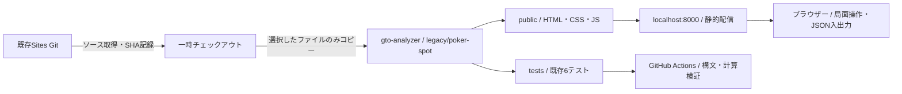
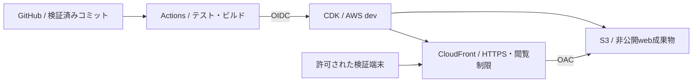

# SPOT-002: 既存サイトのGit取り込み

- 状態: Verified
- 日付: 2026-10-03
- 関連要件: [学習画面の移行](../REQUIREMENTS.md#学習画面のgit管理aws移行)
- 関連設計: [段階的AWS移行](../architecture/POKER_SPOT_AWS.md)
- 実装先: `legacy/poker-spot/`、ルートpackage.json、GitHub CI

## 目的・範囲

SPOT-001の第1段階を独立して実施する。既存サイトのHTML/CSS/JavaScriptと6テストを保存し、リポジトリのルートから起動・検証できるようにする。AWSログイン済みとの申告を受けているが、この段階でAWSリソースは作成しない。TypeScript移植・数値精度変更・機能修正は後続仕様で行う。

## アーキテクチャ図：今回の取り込み

[draw.io形式](../architecture/diagrams/gto-analyzer.drawio)の「Git取り込み」「学習画面 AWS dev」ページに編集可能な図を収録しています。

## アーキテクチャ図：後続AWS移行案

閲覧制限方式は後続設計で確定する。OACはS3直アクセス制限であり本人認証ではない。API・DB・MTT解析はこの図の対象外。

## ファイル対応と契約

| 取得元 | 取込先 | 変更 |
| --- | --- | --- |
| dist/*.html、*.css、*.js | legacy/poker-spot/public/ | 内容をそのまま保存 |
| tests/core.test.js | legacy/poker-spot/tests/core.test.js | importのdistをpublicへ変更 |
| README.md | legacy/poker-spot/UPSTREAM.md | 原文保存 |
| package.json | legacy/poker-spot/package.json | 起動・構文検査のパスをpublicへ変更、localhostのみで配信 |

`.git`、`.openai/hosting.json`、認証情報は取り込まない。取得元コミット・公開URL・ファイルのSHA-256を `SOURCE.json` に記録する。独立したlegacyパッケージとし、新規本番TypeScriptコードからimportしない。依存追加がないためルートworkspacesやロックファイルを変更しない。

ルートに `dev:spot`、`check:spot`、`test:spot` を追加する。既存 `check` に構文検査と6テストを組み込み、既存CIで実行する。Python 3はローカル静的配信のみで使用し、CIのNodeテストにPythonは不要。

## 受入条件

| ID | 操作 | 期待結果 |
| --- | --- | --- |
| SPOT-002-AC01 | 元ソースとpublicのハッシュ比較 | 4ファイルが完全一致、取得元SHAを保存 |
| SPOT-002-AC02 | npm run check | 既存型検査・取込JS構文検査・6テストが成功 |
| SPOT-002-AC03 | npm run dev:spot、HTTP取得 | localhostでHTMLと3アセットが200、配信内容が一致 |
| SPOT-002-AC04 | Git差分確認 | アプリソースが追跡対象。内側の.git、Sites設定、認証情報なし |

ブラウザーでのカード操作・JSON入出力等はSPOT-001の後続受入として区別する。今回のHTTP起動確認だけで画面操作試験済みとはしない。

## 検証記録

2026-10-03:

- AC01: SOURCE.jsonのSHA-256とpublicの4ファイルが一致。
- AC02: `npm run check` 成功（型検査、JS構文検査、6テスト）。既存CIが同じコマンドを実行する。GitHub上のCI結果は未確認。
- AC03: `npm run dev:spot` で起動。HTML・app.js・core.js・style.cssをHTTP取得し、元ファイルとの一致を確認。
- AC04: 取込対象を確認。内側の.git・Sites設定・認証情報を含まない。`git diff --check` 成功。

ブラウザーでの手動操作、TypeScript移植、AWS配信は未実施。
